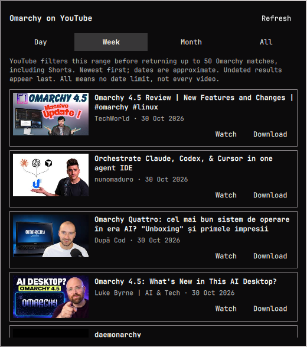

# Omarchy Video Scout

A native Omarchy bar widget for discovering the latest Omarchy videos on
YouTube. Browse thumbnails, filter by day, week, month, or all time, and
watch or download videos with yt-dlp.

Independent community plugin; not affiliated with YouTube or the Omarchy project.



## Requirements

- Omarchy Quattro with its Quickshell-based shell and plugin CLI.
- Python 3 (standard library only).
- A recent `yt-dlp` on PATH for searches and downloads.
- A default browser for Watch actions.
- Internet access. FFmpeg may be needed by yt-dlp to merge video and audio.

No API key, account, administrator privileges, background service, or install
script is required. The plugin does not automatically install dependencies.

## Install

```sh
omarchy plugin add https://github.com/kelmankenberg/Omarchy-Video-Scout.git --enable
```

The plugin ID is `kel.omarchy-video-scout`. Look for the play button on the
right side of the bar. To move it:

```sh
omarchy bar move kel.omarchy-video-scout --section right
```

If you already have the locally created Video Scout at that ID, back it up
outside the plugin directory before replacing it with a Git-managed install.
Do not install a second copy with the same ID.

## Use

Click the play button to open the panel. Choose **Day**, **Week**, **Month**,
or **All**, then select **Watch** or **Download** on a video. Click outside
the panel, press Escape, or click the bar button again to dismiss it.

The standard shell commands also open and close the panel:

```sh
omarchy-shell shell summon kel.omarchy-video-scout '{}'
omarchy-shell shell hide kel.omarchy-video-scout
```

- Opening, refreshing, or changing the range runs a YouTube search.
- The default range is Week; the selection lasts until the plugin reloads.
- Each range is sent to YouTube before applying the 50-result limit.
- Day uses YouTube's last-day filter, not a local midnight cutoff.
- All removes the date restriction; it does not retrieve every matching video.
- Results are sorted newest first using approximate timestamps from YouTube's
  displayed upload ages. Undated results remain visible at the end.
- YouTube determines relevance, so matches can include Shorts, live streams,
  and videos whose titles do not mention Omarchy. There is no additional
  plugin-specific topic, channel, or language filter.
- Logged-out results may differ from your browser's personalized results.
  YouTube indexing and search changes can also affect coverage.

Downloads run one at a time and are saved under:

```text
~/Videos/Omarchy Video Scout/
```

Download only content you own or have permission to download, and respect
applicable terms and laws. Disabling or reloading the plugin while a download
is running can interrupt it.

Both searches and downloads ignore personal yt-dlp configuration so unrelated
options do not change plugin behavior. Browser cookies are not read or passed
to yt-dlp. Restricted videos may therefore be unavailable.

## Network, permissions, and local data

Plugins run unsandboxed inside the Omarchy shell with your user permissions.
Review the source before installation.

The search helper invokes the installed yt-dlp against a fixed HTTPS YouTube
search URL. Searches have a 30-second overall timeout and 15-second socket
timeout. It validates IDs, timestamps, text lengths, result counts, and the
size of captured metadata before handing results to QML.

Thumbnails load from `https://i.ytimg.com` only while the panel is open.
Opening a video launches its YouTube watch URL in your default browser.
Downloading lets yt-dlp contact YouTube and its media delivery hosts.
Those services receive normal network request information, such as your IP.

There are no periodic refreshes, telemetry, stored credentials, or persistent
search history. Results are held in memory; Qt may cache thumbnails. Downloads
and partial downloads remain on disk until you remove them. User configuration
is changed only through explicit Omarchy plugin/bar commands.

## Disable, update, and remove

```sh
omarchy plugin disable kel.omarchy-video-scout
omarchy plugin enable kel.omarchy-video-scout
omarchy plugin update kel.omarchy-video-scout
omarchy plugin remove kel.omarchy-video-scout
```

Removal does not delete downloaded videos.

## Development

From the repository root on an Omarchy installation:

```sh
python3 bin/test_search_videos.py
omarchy plugin validate .
qmllint -I "$OMARCHY_PATH/shell" BarWidget.qml
```

An optional live search check (contacts YouTube):

```sh
python3 bin/search-videos.py day
```

Edit a user-owned plugin copy, never `/usr/share/omarchy`. The shell normally
reloads local changes. If it retains stale QML, use `omarchy restart shell`.
Static validation does not replace checking the running shell for errors.

## Marketplace submission

The repository is being prepared for submission; no marketplace approval is
claimed.

Release checks completed on an Omarchy desktop: clean Git-based installation,
all four filters, thumbnail loading, shell summon/hide, Escape dismissal,
disable/re-enable, shell restart, and removal followed by reinstallation.
Watch was manually confirmed, and a downloaded WebM was checked with FFprobe.
Offline regression tests also run in GitHub Actions.

Before submitting:

- Confirm the license, dependencies, permissions, and removal instructions.
- Submit the public repository through the
  [marketplace form](https://github.com/omacom/omarchy-plugin-marketplace/issues/new?template=submit-plugin.yml).
  Suggested category: **Widgets**. Tags: **Bar**, **Media**, **Quickshell**.

Marketplace approval is for listing and is not a security review.
See the [official publishing guide](https://plugins.omarchy.org/publish.html).

## License

[MIT](LICENSE).
